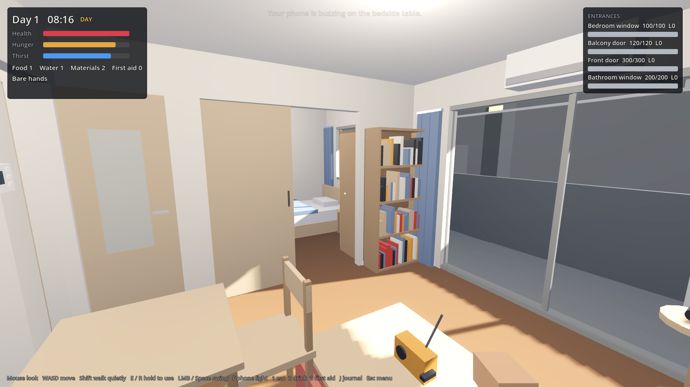

# Keep Living

A first-person roguelite about surviving the end of the world from inside your Tokyo apartment.

It's 07:58 and your phone is screaming. Something has happened outside. You
don't know what yet. Make your 1LDK safe, work out what's going on from the
clues around you, and survive until rescue. When you die, you wake up at 07:58
again. You keep what you learned, and a small advantage (an **Echo**).

Scenario 1, **Outbreak**, is playable: a zombie apocalypse you have to *deduce*
from clues. More scenarios will reuse the same apartment.

Built with **Godot 4.4** (GDScript). Props are made in **Blender**, driven
through Blender MCP or headless scripts.



## Run it

1. Install [Godot 4.4+](https://godotengine.org/download) (standard build, not .NET).
2. Open `project.godot` in Godot and press **F5**, or from a terminal:

```bash
godot --path .
```

## Controls

| Key | Action |
| --- | --- |
| Mouse | Look (click the window to capture the mouse) |
| WASD / arrows | Move |
| Shift | Walk quietly |
| E (hold) | Use what you're looking at: open doors, search, reinforce, secure... |
| R (hold) | Alternate use (patch, dismantle, cook...) |
| Left click / Space | Swing (fists, or the metal bat if you've found it) |
| F | Phone light |
| 1 / 2 / 3 | Eat / drink / use a first-aid kit |
| J or Tab | Journal: clues, insights, theory board, Echoes |
| Esc | Menu |

## The apartment

A typical ~46 m² Tokyo 1LDK on the third floor, laid out on the 910 mm
module Japanese plans use, with 2.4 m ceilings: genkan with a step up and a
shoe cabinet, a hallway, a separate toilet, a washroom (vanity + top-loading
washer) leading to the unit bath, a wall kitchen with a 2-burner gas stove,
a living room with floor-to-ceiling sliding windows onto the balcony, and a
6-jo bedroom behind sliding doors. Outside: the balcony with its
kick-through emergency partitions, and the shared outdoor corridor that
leads to the stairwell.

## How a run plays

- **Days (08:00 to 20:00):** scavenge the apartment, reinforce entrances, secure
  tall furniture, fill the bathtub, read clues. Resting on the bed skips to evening.
- **Nights (20:00 to 06:00):** the infected come along the balconies and up the
  stairwell and hammer on the front door, the balcony door and the windows.
  Noise draws more of them. If an entrance breaks, they come inside.
- **Things you didn't secure kill you too:** earthquakes topple furniture (on you,
  or on your bed while you sleep), an open gas valve leaks after a quake, the
  water stops on day 2, and the power fails on day 3.
- **Survive 5 nights** and you're rescued at dawn on day 6.

**Death keeps two things:** every clue you've found (clues unlock permanent
*insights*), plus one **Echo** you pick from three. Name the apocalypse
correctly on the journal's theory board for a permanent damage bonus.

Full design: [docs/GDD.md](docs/GDD.md).

## Project layout

```
project.godot
scenes/main.tscn              # just a root node; everything is built in code
scripts/
  main.gd                     # assembles a run
  autoload/game_state.gd      # "Game": per-run state (clock, stats, inventory, flags)
  autoload/meta_progress.gd   # "Meta": what survives death (clues, Echoes), saved to user://
  data/scenario_zombie.gd     # scenario 1: clues, insights, theory answer
  data/perks.gd               # Echo definitions
  world/apartment.gd          # the 1LDK layout, furniture placement, navmesh
  world/*.gd                  # interactables: loot, clue sources, hazards, utilities, entrances
  player/player.gd
  enemies/zombie.gd
  systems/night_director.gd   # nightly siege + noise response
  systems/event_director.gd   # earthquakes, water/power cuts, mail
  world/door.gd               # hinged / sliding interior doors
  ui/hud.gd                   # all UI
  dev/smoke_test.gd           # scripted playthrough
assets/models/*.glb           # props from tools/blender/build_props.py
tools/blender/build_props.py  # Blender prop kit (MCP or headless)
docs/                         # GDD, Blender pipeline
```

Every prop is grey-boxed in code. If `assets/models/<name>.glb` exists, the game
uses that model instead, so art can replace boxes one prop at a time. See
[docs/BLENDER_PIPELINE.md](docs/BLENDER_PIPELINE.md).

## Automated check

A scripted playthrough covers: intro, navmesh, clues, looting, barricading,
quake/gas/furniture hazards, night spawns, breach, combat, death and the Echo
choice. It uses a separate save file.

```bash
godot --headless --path . -- --smoke-test
```

Prints `SMOKE OK` and exits 0 on success. Add `--shots=/abs/dir` (without
`--headless`) to save screenshots along the way.
